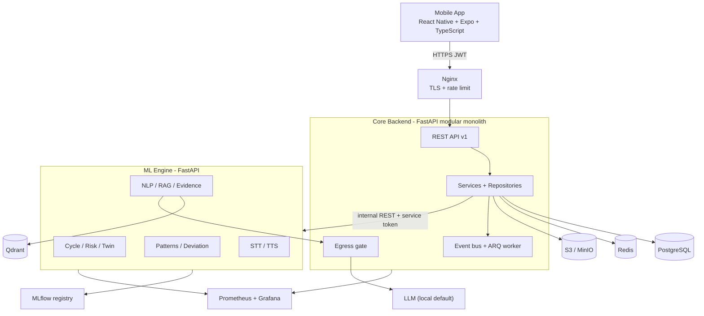

# Diagram 1: Overall System Architecture

> **Implementation status:** Partial: mobile app (tracking + privacy), backend, PostgreSQL, Redis, ARQ worker implemented. ML engine logic, Qdrant, S3, MLflow not yet.

## Diagram source (Mermaid)

## Components

- **Mobile app**: Only client. Talks exclusively to the core backend; never reaches the ML engine.
- **Nginx**: TLS termination, request rate limiting, request-ID injection.
- **Core backend**: Auth, records, consent, audit, orchestration, reports. Owns all user data.
- **Event bus + ARQ worker**: Runs post-save pipelines asynchronously (patterns, deviations, twin, graph).
- **Egress gate**: Single choke point that checks consent and strips identifiers before any LLM call.
- **ML engine**: Stateless inference service for models, NLP, RAG, speech. Receives de-identified features.
- **PostgreSQL / Redis / Qdrant / S3**: Relational truth / cache + queue + denylist / vectors / PDFs.
- **MLflow**: Experiment tracking and model registry.
- **Prometheus + Grafana**: Latency, errors, inference time dashboards.

## Data flow

App -> Nginx -> core API -> service layer -> Postgres. When intelligence is needed the service builds a minimal feature payload and calls the ML engine over a private network. Slow work is queued to the worker. LLM calls leave only via the egress gate.

## Technologies and why they were selected

- **FastAPI**: Async, typed (Pydantic v2), automatic OpenAPI; same language across both services.
- **PostgreSQL**: Relational integrity for health records; JSONB for flexible payloads.
- **Redis**: Cache, ARQ queue broker, JWT denylist, rate limits in one component.
- **Qdrant**: Vector search for the curated knowledge base.
- **Docker Compose**: One-command local stack; same images in deployment.

## Communication with other modules

Mobile<->core: REST/JSON over HTTPS. Core<->ML: REST over private Docker network with service token. Core<->worker: Redis queue.

## Security considerations

ML engine is not published to the host network; two-service limit keeps the attack surface small; secrets only via environment variables.

## Real-world execution example

User opens the dashboard: app calls GET /dashboard, core reads Postgres, fetches a cached cycle prediction from Redis, returns JSON in one round trip.
