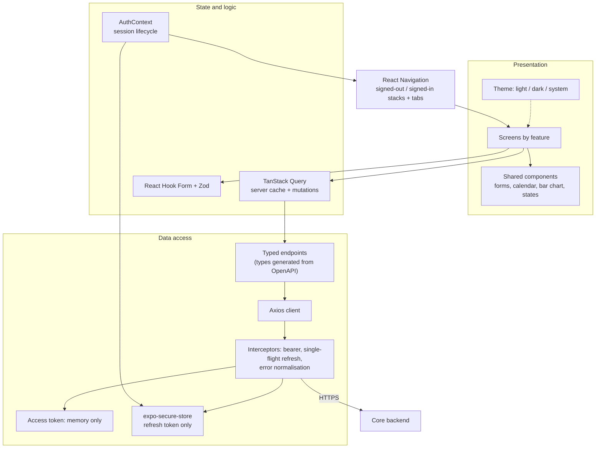

# Diagram 2: Mobile Application Architecture

> **Implementation status:** Implemented (ZIP 3): navigation, auth/session lifecycle, TanStack Query, forms, calendar, bar chart, theme. Native health/audio/notification bridges not yet.

## Diagram source (Mermaid)

## Components

- **Navigation**: RootNavigator chooses the tree from the auth status: splash, offline retry, onboarding, auth stack, or tabs + form screens.
- **Screens**: Today, Cycle, Log, Me and their forms. Later milestones add twin, patterns, time machine, detective, wearables, planner, reports, graph, memory, vault screens.
- **Components**: Form fields (text, date, 1-5 score, chips, switch), month calendar, dependency-free bar chart, loading/empty/error states, ConsentGate.
- **TanStack Query**: Caches server data, invalidates after writes, never retries 4xx, retries flaky networks twice.
- **React Hook Form + Zod**: Client-side validation that mirrors backend rules; the server remains the authority.
- **AuthContext**: Restores the session silently at start, handles login/register/logout, clears the cache on sign-out.
- **Typed endpoints + Axios**: Every route the app calls is listed once; a contract test checks each exists in the backend's OpenAPI document.
- **Interceptors**: Attach the bearer token, refresh once for all concurrent 401s, store the rotated refresh token, normalise errors.
- **Token storage**: Refresh token in the OS keychain/keystore; access token in memory only.

## Data flow

Screen -> Query hook -> typed endpoint -> Axios -> interceptor adds the in-memory access token -> backend. A 401 triggers one shared refresh with the keychain refresh token; the rotated token is saved and the request retried. If the refresh token is rejected the session ends and the cache is cleared.

## Technologies and why they were selected

- **React Native + Expo SDK 58 (dev client)**: One codebase for Android/iOS; EAS builds AAB/IPA; dev client leaves room for native health modules.
- **TypeScript strict + generated API types**: Compile-time contract with the backend.
- **React Navigation + React Native Paper**: Standard navigation and accessible Material 3 components.
- **TanStack Query**: Purpose-built server-state cache; avoids a hand-rolled global store.
- **Custom bar chart**: A few Views, no native dependency, accessible by construction; a chart library can be added when richer charts are needed (Recharts is web-only).

## Communication with other modules

REST/JSON over HTTPS to the core backend only. Native modules in use: secure-store, async-storage (non-sensitive flags), date picker. HealthKit/Health Connect, audio and notifications arrive in later milestones.

## Security considerations

Only the refresh token is persisted (keychain/keystore, device-only); access token in memory; cache cleared on sign-out; no secrets in the bundle; screens never log health data; offline does not sign the user out.

## Real-world execution example

User logs sleep: form validates -> POST /lifestyle (or PUT if that day already has an entry) -> Query invalidates the lifestyle queries -> Today re-renders the sleep bars.
