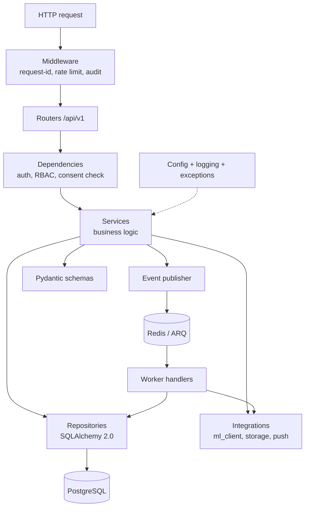

# Diagram 3: Primary Backend Architecture

> **Implementation status:** Implemented for the ZIP 2 scope (middleware, routers, dependencies, services, repositories, events, worker). `integrations/` (ml_client, storage, push) pending.

## Diagram source (Mermaid)

## Components

- **Middleware**: Adds request ID, enforces rate limits, writes audit entries.
- **Routers**: Thin HTTP layer; validation through Pydantic v2 schemas.
- **Dependencies**: JWT verification, role check, per-purpose consent check.
- **Services**: All business rules. Feature modules: conversation, timeline, twin, patterns, deviations, wearables, planner, reports, graph, memory, privacy.
- **Repositories**: Only layer allowed to run SQL; async SQLAlchemy sessions.
- **Integrations**: ml_client (service token), S3 storage, push provider.
- **Event publisher + worker**: Decouples saving a record from analysis.

## Data flow

Request -> middleware -> router -> dependencies -> service -> repository -> DB. Services publish events; the worker consumes them and writes derived data through the same repositories.

## Technologies and why they were selected

- **SQLAlchemy 2.0 + Alembic**: Typed ORM and versioned migrations.
- **Pydantic v2**: Validation and serialization; OpenAPI source.
- **ARQ**: Async-native job queue on Redis; lighter than Celery.
- **Argon2**: Memory-hard password hashing.

## Communication with other modules

Internal calls are plain function calls (modular monolith). External: ML engine REST, S3, push, Redis.

## Security considerations

Authorization at dependency level, not scattered in handlers; repositories always filter by user_id; audit middleware is append-only.

## Real-world execution example

POST /cycles: router validates body, service checks overlap rules, repository inserts, service emits record.confirmed.
