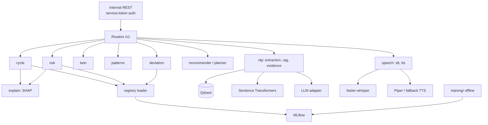

# Diagram 4: AI/ML Service Architecture

> **Implementation status:** Skeleton only (`/health`). Models arrive in ZIP 4.

## Diagram source (Mermaid)

## Components

- **Routers**: Versioned contracts, one per capability.
- **cycle / risk / deviation**: Baselines first, ML only if it beats the baseline on time-split evaluation.
- **twin / patterns**: Per-user statistical models and association/correlation mining.
- **explain**: SHAP for tree models; coefficients for linear twin models.
- **nlp**: Ontology-constrained symptom extraction, RAG retrieval, evidence-type tagging.
- **speech**: faster-whisper STT; TTS where a verified voice exists.
- **registry**: Loads models by stage from MLflow.
- **training/**: Offline scripts and synthetic generators; never trains on live user data.

## Data flow

Request carries only de-identified features. Engine loads the registered model, computes output (+ explanation), returns it. Nothing about users is persisted in the engine.

## Technologies and why they were selected

- **scikit-learn / XGBoost**: Strong on small tabular data.
- **SHAP**: Feature attributions for tree models.
- **MLflow**: Reproducible runs and model registry.
- **sentence-transformers + Qdrant**: Semantic retrieval for RAG.
- **faster-whisper**: Fast multilingual STT; CPU int8 option.

## Communication with other modules

Called only by the core backend. Outbound: Qdrant, MLflow, LLM adapter.

## Security considerations

Not exposed publicly; service token required; payloads carry no names/emails; audio is processed in memory and not stored by default.

## Real-world execution example

Core posts 8 cycle lengths to /v1/cycle/predict; engine returns next-start estimate, interval, SHAP factors, model version.
