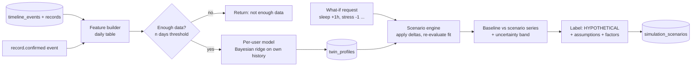

# Diagram 5: Personal Wellness Digital Twin Architecture

> **Implementation status:** Not started (ZIP 4).

## Diagram source (Mermaid)

## Components

- **Feature builder**: Aligns sleep, mood, stress, activity, symptoms, cycle day onto a daily table.
- **Data sufficiency gate**: Refuses to fit below a minimum number of observed days.
- **Per-user model**: Bayesian ridge regression of outcomes (e.g. mood, fatigue entries) on the user's own lifestyle inputs. Coefficients are the explanation.
- **Scenario engine**: Applies requested input changes inside the user's observed range and re-evaluates the fitted relationship.
- **Labeling step**: Every output is stored with is_hypothetical = true and the assumptions used.

## Data flow

Each confirmed record triggers a feature refresh. The twin refits when enough new data exists. A what-if request reads the latest twin profile, perturbs inputs, and returns baseline-versus-scenario curves with uncertainty.

## Technologies and why they were selected

- **scikit-learn BayesianRidge**: Gives uncertainty and works with small samples; interpretable.
- **Pandas / NumPy**: Daily feature table.
- **PostgreSQL**: twin_profiles, simulation_scenarios (CHECK is_hypothetical).

## Communication with other modules

Core twin module requests ML engine /v1/twin/fit and /v1/twin/simulate; mobile reads via /twin endpoints.

## Security considerations

Per-user data only; payload de-identified; consent purpose ml_processing required.

## Real-world execution example

User asks 'what if I sleep 1 hour more?'. If her history shows higher mood on longer-sleep days, the chart shows a modest hypothetical rise with a wide band and the note 'based on associations in your own records, not a biological simulation'.
