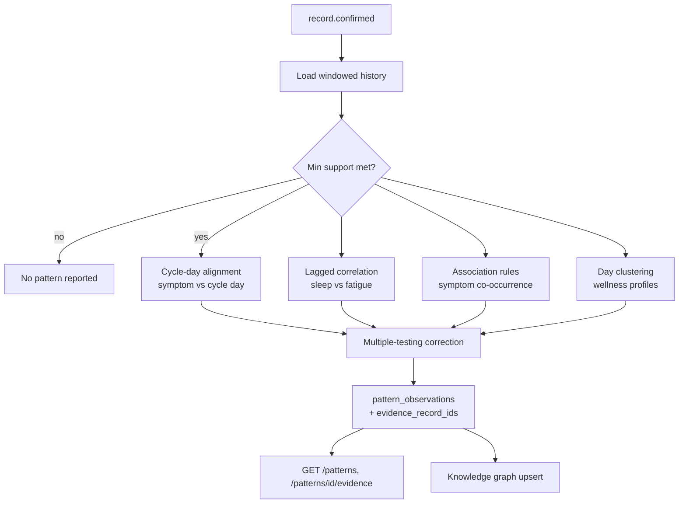

# Diagram 6: Hidden Pattern Detection Workflow

> **Implementation status:** Not started (ZIP 4).

## Diagram source (Mermaid)

## Components

- **Min-support gate**: A pattern needs repeated occurrences (e.g. 3+ cycles) before it is shown.
- **Cycle-day alignment**: Counts when each symptom falls relative to cycle start across cycles.
- **Lagged correlation**: Spearman correlation with 0-2 day lags (sleep vs next-day fatigue).
- **Association rules**: Apriori/FP-growth on daily symptom sets (support, confidence, lift).
- **Clustering**: k-means/GMM on daily feature vectors to find recurring day types.
- **FDR correction**: Benjamini-Hochberg to limit false discoveries.
- **Evidence IDs**: Every observation stores the exact record IDs behind it.

## Data flow

Event triggers a windowed re-analysis. Candidate patterns pass support and FDR filters, then are stored with evidence record IDs and rendered as timelines/heatmaps.

## Technologies and why they were selected

- **SciPy / statsmodels**: Correlation and multiple-testing correction.
- **mlxtend**: Association rule mining.
- **scikit-learn**: Clustering.

## Communication with other modules

Worker calls ML engine /v1/patterns/analyze; results persisted by core; graph module consumes observations.

## Security considerations

Runs per user; evidence IDs never leave the user's scope; wording uses 'tends to appear with', never causal language.

## Real-world execution example

Headache entries fall on cycle days 1-2 in 3 of 3 recorded cycles: the card lists those 3 headache logs and their dates.
