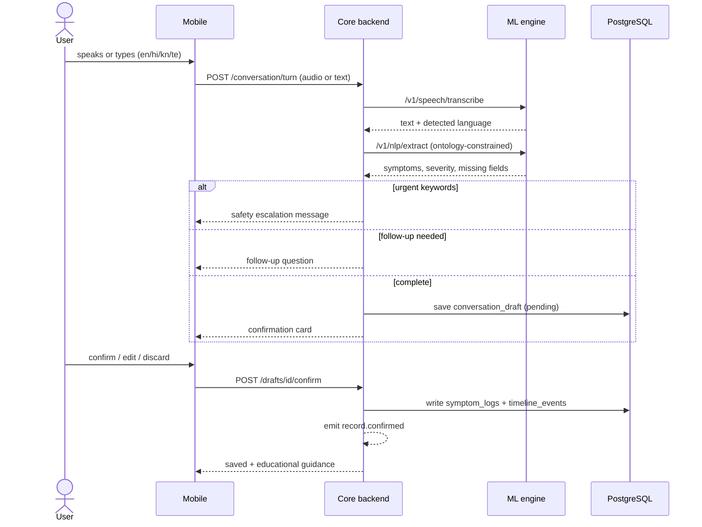

# Diagram 7: Multilingual Symptom Detective Workflow

> **Implementation status:** Not started (ZIP 5). Only the `symptom_logs.source` column and ontology codes exist.

## Diagram source (Mermaid)

## Components

- **STT**: faster-whisper with language detection; reports confidence.
- **Extraction**: LLM constrained to a fixed multilingual symptom ontology, with lexicon/rule fallback. Unknown terms are returned as 'unrecognized', never invented.
- **Follow-up policy**: Asks only for missing fields (severity, onset, duration).
- **Safety interceptor**: Rule-based urgent-symptom detection that runs before the LLM and returns a fixed reviewed message.
- **Draft store**: conversation_drafts; nothing enters health tables until user confirms.

## Data flow

Audio/text -> transcript -> extraction -> follow-ups -> confirmation card -> explicit confirm -> structured records -> event. Server enforces that only confirmed drafts can be written.

## Technologies and why they were selected

- **faster-whisper**: Multilingual; Kannada/Telugu accuracy will be measured, not assumed.
- **YAML symptom ontology (en/hi/kn/te)**: Deterministic anchor; prevents invented symptoms.
- **LLM adapter (local default)**: Structured JSON extraction; passes through egress gate.

## Communication with other modules

Mobile -> core only. Core -> ML engine for STT and extraction. Core -> Postgres for drafts and records.

## Security considerations

Audio not stored by default; drafts expire; confirmation required server-side; LLM calls via egress gate.

## Real-world execution example

'Mujhe aaj bahut thakaan hai aur sir dard bhi hai' -> fatigue + headache detected, asks severity, user confirms, two symptom_logs saved.
