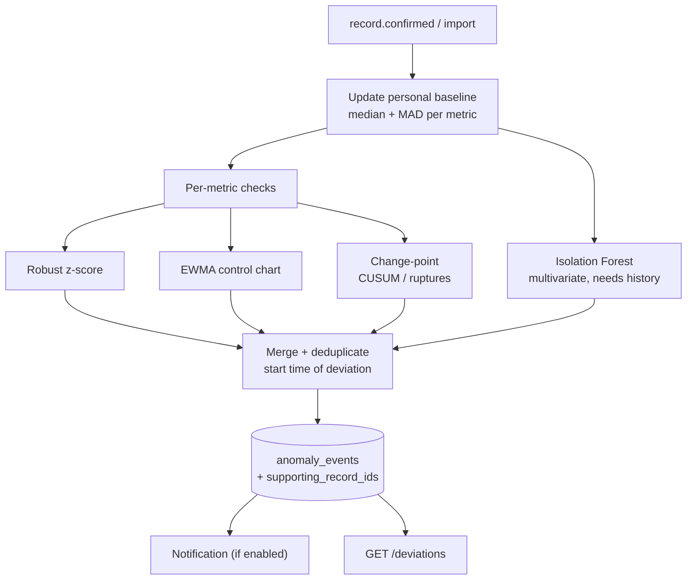

# Diagram 8: Wellness Deviation Detection Workflow

> **Implementation status:** Not started (ZIP 4).

## Diagram source (Mermaid)

## Components

- **Personal baseline**: Median and MAD over a rolling window of the user's own data; stored in wellness_baselines.
- **Univariate detectors**: Robust z-score, EWMA, CUSUM/change-point per metric (sleep, mood, activity, symptom frequency, cycle length).
- **Isolation Forest**: Used only when enough multivariate history exists.
- **Merge step**: Combines simultaneous deviations and finds the estimated start date.
- **anomaly_events**: Stores method, score, status, and the records behind each event.

## Data flow

New data updates the baseline, detectors run, results are merged into events with start time and evidence, and optionally trigger a notification. Wording: 'differs from your usual pattern', never a diagnosis.

## Technologies and why they were selected

- **NumPy/SciPy**: Robust statistics.
- **ruptures**: Change-point detection.
- **scikit-learn IsolationForest**: Multivariate anomaly scoring.

## Communication with other modules

Worker -> ML engine /v1/deviation/detect; core stores events; mobile shows them in Insights.

## Security considerations

Per-user baselines; thresholds documented; no disease labels.

## Real-world execution example

Average sleep drops from ~7.2h to ~5.4h for 6 nights while fatigue entries rise: one event 'started 6 days ago: sleep duration, fatigue entries'.
