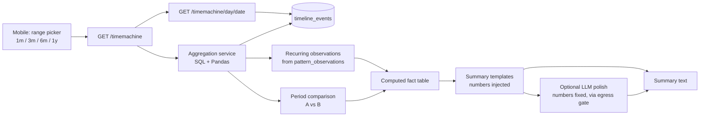

# Diagram 9: Wellness Time Machine Architecture

> **Implementation status:** Partial: `timeline_events` read model is written on every record change; aggregation/comparison/summaries not yet.

## Diagram source (Mermaid)

## Components

- **timeline_events**: Unified read model fed by confirmed records and imports.
- **Aggregation service**: Weekly/monthly means, symptom counts, cycle stats per window.
- **Comparison**: Computes differences between two periods.
- **Fact table**: The only source of numbers used in any summary.
- **Template summaries**: Deterministic sentences from computed facts; LLM polishing is optional and cannot change figures.

## Data flow

Pick a range -> aggregate -> compute comparisons -> produce facts -> render summary. Tapping a point opens the actual day records.

## Technologies and why they were selected

- **PostgreSQL window functions**: Efficient time-bucketed aggregation without a separate time-series DB.
- **Pandas**: Comparison calculations.

## Communication with other modules

Core backend module; optionally calls ML engine for text polish.

## Security considerations

All queries scoped by user_id; summaries contain only values computed from the user's records.

## Real-world execution example

'Compared with your first month, average recorded sleep rose from 6.1h to 6.9h and fatigue entries fell from 9 to 4.'
