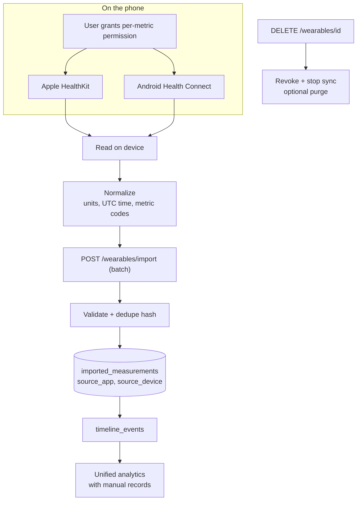

# Diagram 10: Multimodal Data Integration Workflow

> **Implementation status:** Not started (ZIP 5).

## Diagram source (Mermaid)

## Components

- **Platform readers**: HealthKit (iOS) and Health Connect (Android) via native modules.
- **Permission step**: Per-metric consent; nothing is read without it.
- **Normalizer**: Maps platform types to internal metric codes and units.
- **Import API**: Idempotent batch ingestion with dedupe hash.
- **imported_measurements**: source_app and source_device are mandatory (attribution).
- **Disconnect**: Revokes integration; user can also delete imported data.

## Data flow

Device read -> normalize -> upload -> validate/dedupe -> store with source -> merge into the timeline -> analytics treat manual and imported data side by side, labeled by source.

## Technologies and why they were selected

- **Expo dev client + native health modules**: Required because Expo Go cannot access HealthKit/Health Connect.
- **PostgreSQL**: Unique dedupe constraint.

## Communication with other modules

Mobile -> core /wearables/*. Not testable without a physical device; ingestion logic is unit-tested separately.

## Security considerations

Minimum scopes; user can disconnect at any time; heart-rate/HRV never interpreted as hormones or diagnoses; UI states when no device is connected.

## Real-world execution example

Watch reports 6h 12m sleep; stored with source 'Apple Watch / Health'; shown beside manual entry for that night.
