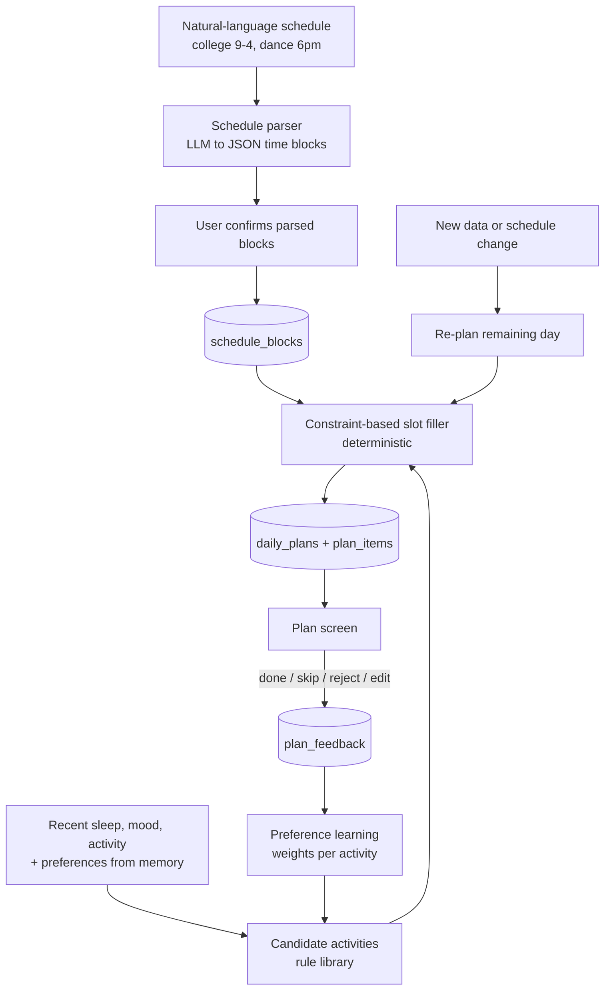

# Diagram 11: Adaptive Wellness Planner Workflow

> **Implementation status:** Not started (ZIP 6).

## Diagram source (Mermaid)

## Components

- **Schedule parser**: LLM only converts free text to time blocks; output is shown for confirmation.
- **Rule library**: Curated, referenced suggestions (movement, hydration, wind-down, meals). No cycle-phase restrictions.
- **Slot filler**: Deterministic algorithm placing activities in free time within duration/buffer constraints.
- **Feedback + preference learning**: Accept/skip/reject updates per-activity weights.
- **Adaptation**: Re-plans the rest of the day when data or schedule changes.

## Data flow

Parse -> confirm -> generate candidates from recent data and preferences -> place into free slots -> user acts on items -> feedback updates weights -> next plan reflects them.

## Technologies and why they were selected

- **Deterministic scheduler (Python)**: Testable and predictable; LLM is not trusted with timing.
- **Simple weighted preference model**: Works with tiny feedback volumes.

## Communication with other modules

Core planner module; ML engine for parsing and optional ranking; reads memory preferences.

## Security considerations

Schedule text is personal data: egress gate applies; stored encrypted.

## Real-world execution example

'College 9-4, dance 6pm' -> free windows 4-6pm and after 7:30pm; plan places a 20-min walk at 4:15pm, hydration reminders, and a wind-down at 10pm.
