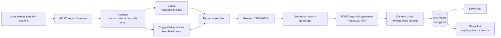

# Diagram 12: Doctor-Visit Report Generation Workflow

> **Implementation status:** Not started (ZIP 6).

## Diagram source (Mermaid)

## Components

- **Collector**: Reads only records the user selected and confirmed.
- **Chart renderer**: Server-side charts embedded in the PDF.
- **Question library**: Template questions chosen from observed patterns.
- **Preview + edit**: User can edit free-text notes and questions; recorded data stays read-only.
- **Content check**: Automated test blocks diagnostic wording.
- **Sharing**: Hashed tokens with expiry, revocation, and access count.

## Data flow

Select -> preview -> edit -> generate PDF -> store in encrypted object storage -> download or share by revocable link.

## Technologies and why they were selected

- **ReportLab**: Precise, professional PDF layout in Python.
- **matplotlib**: Chart images for PDF.
- **S3 / MinIO**: Encrypted file storage with presigned access.

## Communication with other modules

Core reports module (async job for generation); reads timeline, patterns, deviations.

## Security considerations

Sharing is explicit and revocable; share events are audit-logged; links store only token hashes.

## Real-world execution example

Last 3 months: cycle table, symptom frequency, sleep/mood trends, 5 suggested questions; user edits one note and shares for 7 days.
