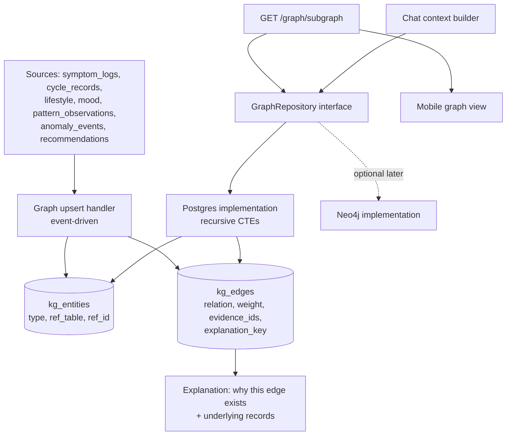

# Diagram 13: Personal Health Knowledge Graph Architecture

> **Implementation status:** Not started (ZIP 5).

## Diagram source (Mermaid)

## Components

- **Upsert handler**: Creates entities and edges from confirmed records and detected patterns.
- **kg_entities / kg_edges**: Typed nodes referencing source rows; edges carry weight, evidence IDs, and an explanation key.
- **GraphRepository**: Interface so storage can change without touching callers.
- **Postgres implementation**: Recursive CTEs for 2-3 hop traversal.
- **Neo4j implementation (optional)**: Not shipped by default; added only if variable-depth traversal at scale is needed.
- **Context builder**: Feeds relevant subgraph facts to chat (allowlisted).

## Data flow

Event -> upsert nodes/edges -> API returns a user-scoped subgraph -> UI draws it and each edge can show its evidence -> chat can retrieve connected facts.

## Technologies and why they were selected

- **PostgreSQL recursive CTEs**: Per-user graphs are small; no extra database to operate.
- **Neo4j (deferred)**: Valuable for deep traversal across large graphs; documented trade-off, not added for appearance.

## Communication with other modules

Internal core module; ML engine receives graph-derived context only when building chat prompts.

## Security considerations

All traversals scoped to one user_id; edges always reference real records; deletion cascades with account erasure.

## Real-world execution example

Edge 'poor sleep -> fatigue (lag 1d)' links to 9 sleep logs and 7 fatigue entries; tapping it lists them.
