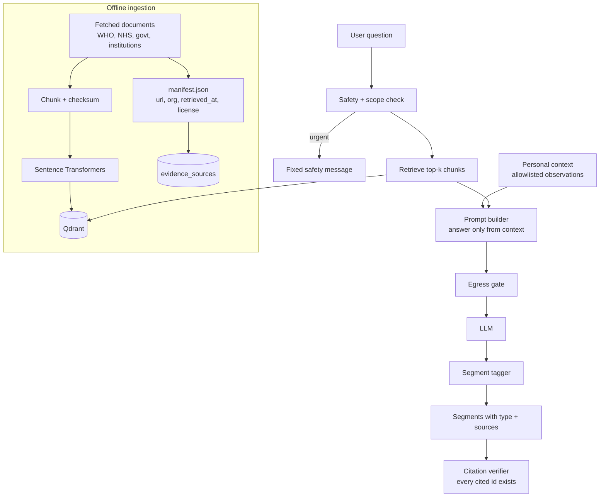

# Diagram 14: RAG and Evidence Engine Architecture

> **Implementation status:** Not started (ZIP 5).

## Diagram source (Mermaid)

## Components

- **Ingestion**: Only documents actually fetched and stored; manifest records URL, publisher, date, license, checksum.
- **Qdrant**: Vector index of chunks with source metadata.
- **Safety + scope check**: Urgent symptoms and diagnosis requests are intercepted or refused.
- **Prompt builder**: Instructs the model to answer only from retrieved context and personal records.
- **Segment tagger**: Labels each segment: supported evidence / general wellness / personal observation / hypothetical / uncertain.
- **Citation verifier**: Rejects any citation not present in evidence_sources, preventing fabricated references.

## Data flow

Question -> safety -> retrieval -> prompt (evidence + allowed personal facts) -> LLM -> tag segments -> verify citations -> return segments with sources and an uncertainty note when retrieval is weak.

## Technologies and why they were selected

- **Sentence Transformers**: Local embeddings; no text sent out for vectorization.
- **Qdrant**: Filterable vector search with payload metadata.
- **Custom RAG (no LangChain)**: Small, auditable pipeline.

## Communication with other modules

Core chat gateway -> ML engine /v1/chat/respond; engine -> Qdrant, LLM adapter.

## Security considerations

Egress gate; personal context only from user allowlist; KB provenance tracked; no fabricated references.

## Real-world execution example

'Is a 35-day cycle normal?' -> retrieved guidance chunk (cited) + personal note 'your last 3 cycles were 33-36 days' + advice to discuss persistent variation with a clinician.
