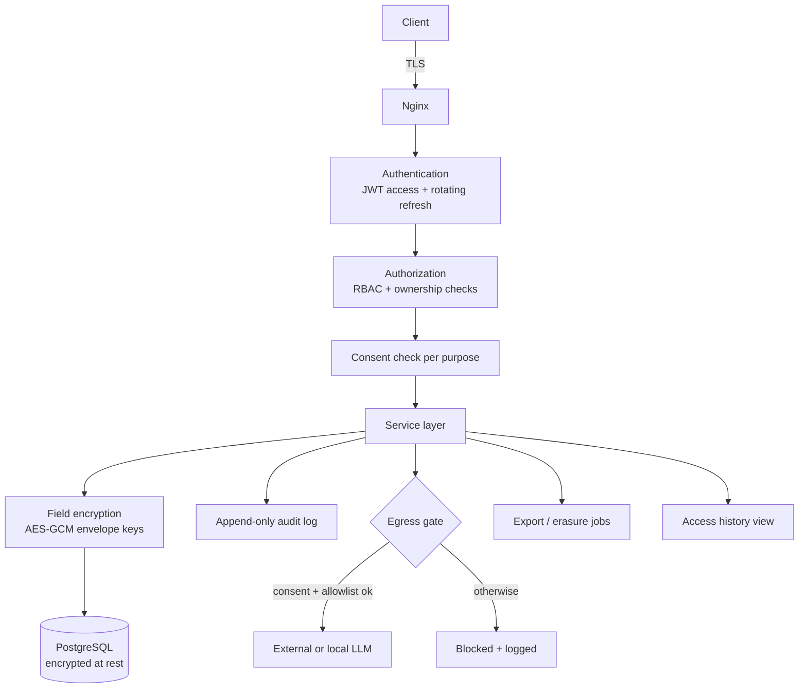

# Diagram 15: Privacy and Security Architecture

> **Implementation status:** Partial: Argon2, JWT + rotating refresh with reuse detection, denylist, RBAC, ownership, consent gating, AES-GCM field encryption, append-only audit, egress gate, export and erasure are implemented and tested. Mobile token storage (keychain) added in ZIP 3. KMS envelope keys, TLS termination, S3/Qdrant purge pending.

## Diagram source (Mermaid)

## Components

- **JWT + refresh rotation**: Short-lived access tokens, revocable refresh tokens, Redis denylist.
- **RBAC + ownership**: Role plus per-row user_id enforcement.
- **Consent check**: Purposes: health_tracking, ml_processing, llm_external, analytics.
- **Field encryption**: Application-level AES-GCM for notes, chat text, schedule text.
- **Audit log**: Append-only; users can view their own access history.
- **Egress gate**: Blocks external LLM calls unless consent, allowlist and de-identification pass.
- **Export / erasure**: Machine-readable export; hard-purge after soft delete.

## Data flow

Every request passes authn -> authz -> consent before reaching services. Sensitive fields are encrypted before storage. Any outbound AI call must pass the egress gate. All sensitive actions are audit-logged.

## Technologies and why they were selected

- **Argon2**: Password hashing.
- **AES-GCM (cryptography lib)**: Authenticated field encryption.
- **Redis**: Token denylist and rate limits.
- **PostgreSQL grants**: Audit table without UPDATE/DELETE privileges.

## Communication with other modules

Cross-cutting: applies to core, ML engine (service token), storage, and LLM adapter.

## Security considerations

This diagram is the security model. Production keys come from a managed KMS/secret store; threat model documented separately in later milestones.

## Real-world execution example

User turns off 'external AI': the next chat request is answered by the local model or declined; the blocked attempt appears in her access history.
