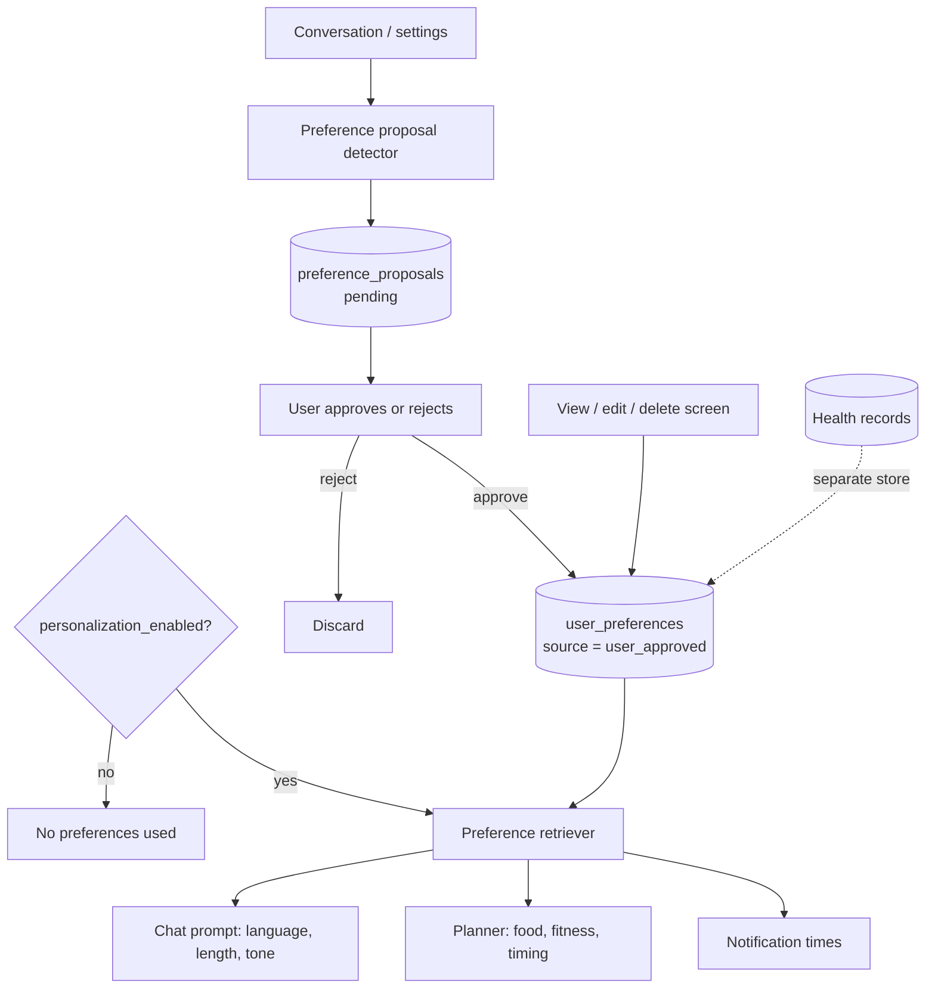

# Diagram 16: Wellness Memory Architecture

> **Implementation status:** Not started (ZIP 5).

## Diagram source (Mermaid)

## Components

- **Proposal detector**: Suggests preferences it noticed; it never stores them directly.
- **preference_proposals**: Pending items awaiting explicit approval.
- **user_preferences**: Approved key-value items: language, response length, diet, fitness, notification time, tone.
- **Master switch**: personalization_enabled turns the whole system off.
- **Retriever**: Selects only relevant preferences per context.
- **Separation rule**: Preferences are stored apart from medical/health history; sensitive health conclusions are never inferred into memory.

## Data flow

Detect -> propose -> user approves -> stored -> retrieved by chat, planner and notifications -> user can view, edit, or delete at any time.

## Technologies and why they were selected

- **PostgreSQL key-value tables**: Simple, transparent, exportable.

## Communication with other modules

Core memory module read by conversation, planner, notification services.

## Security considerations

Included in export and erasure; excluded from LLM context unless the user allows it.

## Real-world execution example

User says 'keep answers short' -> proposal appears -> she approves -> later answers are concise.
