# Diagram 17: Complete Database ER Diagram

> **Implementation status:** 13 of 41 tables migrated (Alembic 0001). The diagram shows the full design.

## Diagram source (Mermaid)

```mermaid
erDiagram
    USERS ||--|| HEALTH_PROFILES : has
    USERS ||--o{ REFRESH_TOKENS : holds
    USERS ||--o{ PASSWORD_RESET_TOKENS : requests
    USERS ||--o{ USER_CONSENTS : grants
    USERS ||--o{ AUDIT_LOGS : generates
    USERS ||--o{ CYCLE_RECORDS : logs
    USERS ||--o{ SYMPTOM_LOGS : logs
    USERS ||--o{ LIFESTYLE_RECORDS : logs
    USERS ||--o{ MOOD_RECORDS : logs
    CYCLE_RECORDS ||--o{ SYMPTOM_LOGS : links
    USERS ||--o{ TIMELINE_EVENTS : owns
    USERS ||--o{ PREDICTIONS : receives
    PREDICTIONS ||--o{ EXPLANATIONS : has
    USERS ||--o{ RISK_ASSESSMENTS : receives
    USERS ||--o{ RECOMMENDATIONS : receives
    USERS ||--o{ WELLNESS_BASELINES : has
    USERS ||--o{ ANOMALY_EVENTS : has
    USERS ||--o| TWIN_PROFILES : has
    TWIN_PROFILES ||--o{ SIMULATION_SCENARIOS : runs
    USERS ||--o{ PATTERN_OBSERVATIONS : has
    USERS ||--o{ CONVERSATION_DRAFTS : drafts
    USERS ||--o{ CHAT_SESSIONS : starts
    CHAT_SESSIONS ||--o{ CHAT_MESSAGES : contains
    USERS ||--o{ WEARABLE_INTEGRATIONS : connects
    WEARABLE_INTEGRATIONS ||--o{ IMPORTED_MEASUREMENTS : supplies
    USERS ||--o{ SCHEDULE_BLOCKS : defines
    USERS ||--o{ DAILY_PLANS : receives
    DAILY_PLANS ||--o{ PLAN_ITEMS : contains
    PLAN_ITEMS ||--o{ PLAN_FEEDBACK : receives
    USERS ||--o{ KG_ENTITIES : owns
    KG_ENTITIES ||--o{ KG_EDGES : source
    EVIDENCE_SOURCES ||--o{ EVIDENCE_CHUNKS : split_into
    USERS ||--o{ USER_PREFERENCES : approves
    USERS ||--o{ PREFERENCE_PROPOSALS : reviews
    USERS ||--|| AI_SETTINGS : configures
    USERS ||--o{ GENERATED_REPORTS : owns
    GENERATED_REPORTS ||--o{ REPORT_SHARES : shared_via
    USERS ||--o{ NOTIFICATIONS : receives
    USERS ||--o{ NOTIFICATION_PREFERENCES : configures
    USERS ||--o{ PIPELINE_RUNS : triggers
```

## Components

- **Identity and governance**: users, health_profiles, refresh_tokens, password_reset_tokens, user_consents, audit_logs, ai_settings.
- **Core records**: cycle_records, symptom_logs, lifestyle_records, mood_records.
- **Unified timeline**: timeline_events is the read model used by Time Machine, patterns and reports.
- **Intelligence outputs**: predictions (+explanations), risk_assessments, recommendations, wellness_baselines, anomaly_events, twin_profiles, simulation_scenarios, pattern_observations.
- **Conversation**: conversation_drafts, chat_sessions, chat_messages.
- **Integrations**: wearable_integrations, imported_measurements.
- **Planner**: schedule_blocks, daily_plans, plan_items, plan_feedback.
- **Graph and evidence**: kg_entities, kg_edges, evidence_sources, evidence_chunks.
- **Memory, reports, ops**: user_preferences, preference_proposals, generated_reports, report_shares, notifications, notification_preferences, pipeline_runs.

## Data flow

Relationships only are drawn here to stay readable; column-level definitions, constraints and indexes are in docs/db/schema.md. Almost every table hangs off users with ON DELETE CASCADE so erasure is complete.

## Technologies and why they were selected

- **PostgreSQL 16**: ACID relational store; JSONB, arrays, partial indexes, recursive CTEs.
- **Alembic**: Versioned schema changes.

## Communication with other modules

Accessed only by the core backend repositories (and the ARQ worker through the same repositories).

## Security considerations

UUID keys, per-row ownership, encrypted free-text columns, append-only audit_logs, cascade deletion.

## Real-world execution example

Deleting an account cascades through every user-owned table, leaving only anonymous evidence_sources (shared reference data).
