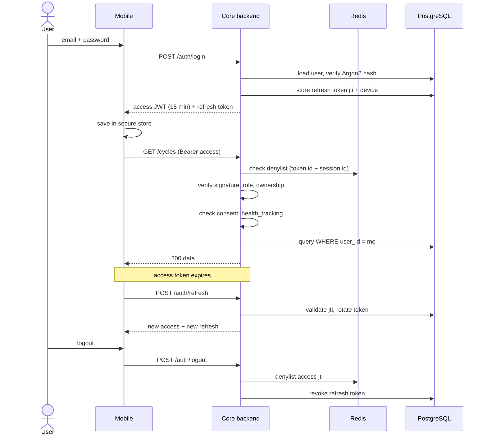

# Diagram 18: Authentication and Authorization Sequence

> **Implementation status:** Implemented and tested end to end (backend + the mobile client against a live backend); matches the code.

## Diagram source (Mermaid)

## Components

- **Login**: Verifies Argon2 hash; issues short-lived access JWT and rotating refresh token.
- **Refresh rotation**: Each refresh invalidates the old token; reuse of an old token revokes the session family.
- **Denylist**: Redis set of revoked access token IDs until expiry.
- **Ownership + consent**: Checked on every protected route.

## Data flow

Credentials -> tokens -> authenticated calls -> silent refresh -> logout revokes both tokens.

## Technologies and why they were selected

- **JWT (HS256 or RS256)**: Stateless access checks.
- **Argon2**: Resistant to GPU cracking.
- **expo-secure-store**: OS-backed secret storage on device.

## Communication with other modules

Mobile <-> core only.

## Security considerations

Rate-limited login, generic error messages, refresh reuse detection, audit entries for login/logout/failures.

## Real-world execution example

Stolen old refresh token is replayed: backend detects reuse, revokes the family, and the user must log in again.
