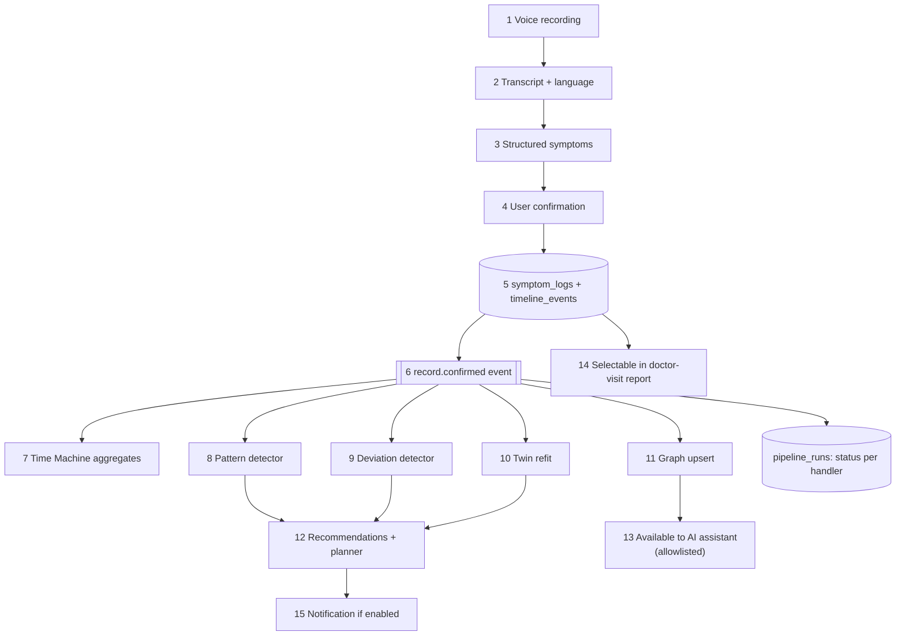

# Diagram 19: Main Application Data Flow (Fatigue Example)

> **Implementation status:** Partial: steps 5-6 (single transactional write + `record.confirmed` event with pipeline tracking) are implemented; other steps are not.

## Diagram source (Mermaid)

## Components

- **Steps 1-4**: Conversation and confirmation (see diagram 7).
- **Step 5**: Single transactional write of records and timeline event.
- **Event + handlers**: Independent, idempotent handlers; each logged in pipeline_runs.
- **Recommendations / planner**: Consume outputs of pattern, deviation and twin handlers.
- **Chat and reports**: Read the same stored records; no separate copy.

## Data flow

Confirmed data is written once, then fans out through events. Every consumer reads from the same tables, so modules stay consistent.

## Technologies and why they were selected

- **ARQ + Redis**: Reliable async execution with retries.
- **pipeline_runs table**: Observability and retry of failed handlers.

## Communication with other modules

Core services -> Redis queue -> worker -> ML engine -> core repositories.

## Security considerations

Handlers act only on the event's user_id; failures never expose data; retries are idempotent.

## Real-world execution example

'I'm tired and have a headache' confirmed at 21:04; by 21:05 the timeline shows both, a deviation check has run, and the assistant can reference them if she allows it.
