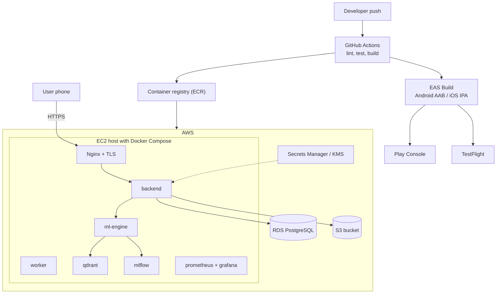

# Diagram 20: Deployment Architecture

> **Implementation status:** Configuration written (Compose, nginx, Prometheus, CI); not executed in the authoring sandbox.

## Diagram source (Mermaid)

## Components

- **GitHub Actions**: CI (lint, tests, image build) and deploy.
- **EAS Build**: Cloud builds of Android AAB/APK and iOS IPA without a local Mac.
- **EC2 + Docker Compose**: Single host for the demo-scale deployment; ml-engine/qdrant/mlflow stay on the internal network.
- **RDS PostgreSQL**: Managed database with encryption at rest and backups.
- **S3**: Encrypted report storage.
- **Secrets Manager / KMS**: Source of secrets and encryption keys in production.

## Data flow

Push -> CI -> images to registry -> deploy on EC2; mobile builds go through EAS to Play/TestFlight. Phones reach only Nginx.

## Technologies and why they were selected

- **Docker Compose**: Simple, reproducible; ECS/EKS only if scale requires.
- **Terraform or CloudFormation (planned)**: Reproducible infrastructure.

## Communication with other modules

Public: HTTPS to Nginx. Everything else private.

## Security considerations

Security groups allow only 80/443; RDS private subnet; no secrets in images; TLS via ACM/Let's Encrypt.

## Real-world execution example

Merge to main -> tests pass -> new backend image deployed with a rolling container restart; health endpoint confirms.
